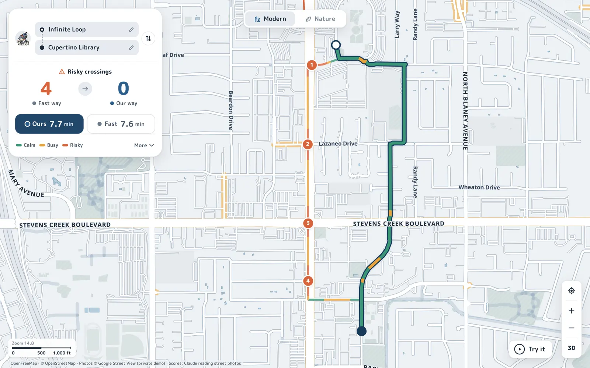
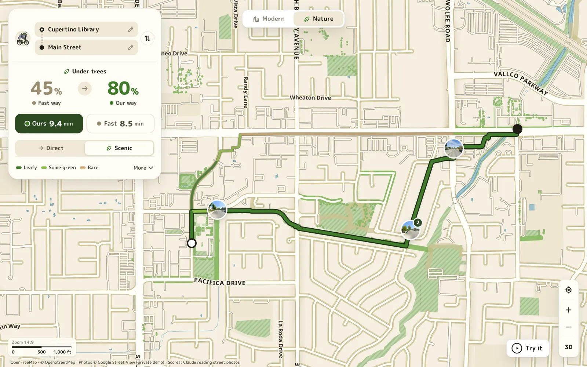

# BikeScape

A bike map for Cupertino that knows how each street feels to ride, not just how long it is.

- **Fast & Safe** finds a quick route that avoids stressful roads and risky crossings.
- **Nature** bends the route through trees, parks and quiet streets. A slider sets how much detour you'll accept.
- Click any street to see its score and the reason behind it.

| Fast & Safe | Nature |
|---|---|
|  |  |

Demo video: [youtube.com/watch?v=dWFIR92aII8](https://www.youtube.com/watch?v=dWFIR92aII8)

## Why

Map apps send bikes the shortest way. In Cupertino that often means 6-lane arterials like Stevens Creek Blvd or crossings at Lawrence Expressway. A bike-lane map doesn't fix this: a painted lane next to 40 mph traffic is still stressful, and a quiet street with no lane can be perfect. A rider needs a judgement for every street.

## How it works

1. **Map.** The whole Cupertino street network from OpenStreetMap, joined with the City of Cupertino's bikeway map.
2. **Photos.** A check point every 80 m on roads and at junctions; 8,931 Google Street View photos, all inside the free tier.
3. **Scoring.** Claude Haiku looks at each photographed spot twice: once for safety, using Level of Traffic Stress (a published traffic-engineering standard), and once for greenery and shade. 10,959 calls cost **$2.38** in total.
4. **Routing.** Each street's median score is baked into a routing graph. Dijkstra searches on "felt distance": low-scored streets and intersections count as longer than they are, with a cap on how much detour a route may add.
5. **Validation.** Real CCRS bike-crash records are used only to check the scores, never to compute them.

Everything is precomputed, so a route request needs no outside service. One route takes about 9 ms on a laptop.

| Number | What |
|---|---|
| 8,514 / 19,817 | Junctions / directed street segments in the graph |
| 95% | Drivable street length (355 km) scored from photos; the rest uses map data |
| 8,931 | Street View photos fetched, $0 |
| 10,959 / $2.38 | Claude scoring calls / total cost |
| ~9 ms | One route request (25 ms p95) |

These numbers come from the Cupertino scoring run and are worked through in [docs/backend-story.md](docs/backend-story.md). The map has since been extended south-east (I-280, San Tomas Aquino Rd, Prospect Rd → Hamilton Ave).

## Run it

Needs Node and [uv](https://docs.astral.sh/uv/).

```
npm install
npm run dev        # map at http://localhost:5173
npm run dev:js     # without the Python service, if uv isn't installed
```

Street View photos are not in the repo. Without them the map and routes work, but the street card shows no photo.

### Presentation

The pitch deck is a web app in [presentation/](presentation/).

```
cd presentation
npm install
npm run dev        # http://localhost:5174
```

Arrow keys or Space to move, **F** fullscreen, **O** overview, **N** speaker notes. Script: [PRESENTATION.md](PRESENTATION.md).

## Stack

| Part | What |
|---|---|
| Map app | React, Vite, Tailwind, MapLibre GL (`web/src/bikemap/`) |
| Routing service | Python, FastAPI, osmnx, networkx (`py/app/bikemap/`) |
| Scoring pipeline | `py/scripts/1_build_graph.py` → `2_photos.py` → `3_score.py` → `4_bake.py` |
| Presentation | React, Three.js, Leaflet (`presentation/`) |

The graph and scores are committed. Photos, raw model replies and keys are not. Scoring prompts and schemas: [.plans/scoring-spec.md](.plans/scoring-spec.md).

## History

- The app sits on [MVP_demo](https://github.com/blar-tw/MVP_demo), a generic MIT starter (auth, database, API, Python side-car) written before BikeScape. Its documentation is in [DEPLOY.md](DEPLOY.md) and [REBUILD.md](REBUILD.md); everything under `py/app/bikemap/`, `py/scripts/`, `web/src/bikemap/` and `presentation/` is BikeScape.
- Inspired by [Aggie Street Smart](referenceproject.md) (HackDavis 2026).

## License

MIT; see [LICENSE](LICENSE).
